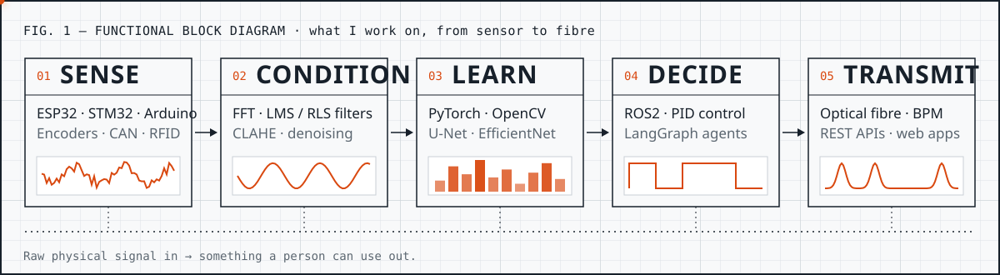
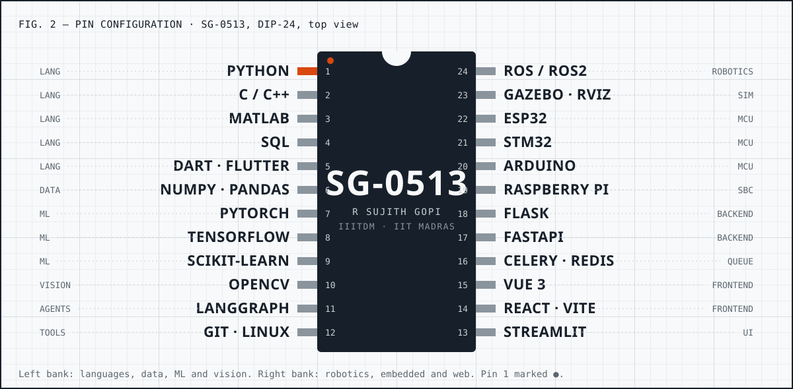
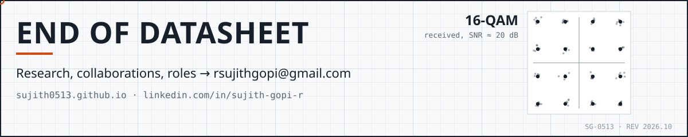

  
  
  

## 1 · General description

I like problems where hardware, signals and code meet. Right now that means light in optical fibres: I'm spending my final year at **IIT Madras** in the Optical Communication Testbed Lab, working out how to join fibres while losing as little light as possible.

Before that I wrote vision code for underwater robots, helped build a robot arm that teaches children to write, and trained deep learning models on retinal scans and old manuscripts. I'm doing a B.Tech in ECE at **IIITDM Kancheepuram** alongside a BS in Data Science from **IIT Madras**.

## 2 · Specifications

| Parameter | Value | Conditions |
|:---|:---|:---|
| Primary degree | B.Tech, Electronics & Communication | IIITDM Kancheepuram · 2023 – 2027 |
| CGPA | **9.46** / 10 | 2nd rank in ECE (Academic Proficiency Award, 2026) |
| Parallel degree | BS, Data Science & Applications | IIT Madras · CGPA **8.49** · Subject Topper Award |
| Current mode | Exchange student, Dept. of EE | IIT Madras · Jul 2026 – May 2027 |
| Lab | Optical Communication Testbed Lab | Prof. Deepa Venkitesh |
| Operating range | Photonics · DSP · Computer vision · ML · Embedded | Comfortable from microcontroller to model to web app |

## 3 · Functional block diagram

## 4 · Operating history

| Period | Role | Organisation |
|:---|:---|:---|
| May 2026 – now | **Summer Fellow → Exchange Student.** Beam propagation simulator for GRIN fibres; markerless core detection and splice-loss prediction for 4-core fibre | IIT Madras, Dept. of EE |
| Apr 2024 – Feb 2026 | **Software team member.** Underwater gate and colour detection in OpenCV; navigation and mission logic in ROS | AUV Club, IIITDM |
| Jul 2025 | **Embedded Systems Intern.** Compressor ON/OFF timing and power use from sensor data; vibration FFT on STM32 and Arduino | ADHVX Industries, Chennai |
| Mar – Jun 2025 | **Data Analyst Intern.** Four end-to-end ML projects, each shipped as a Flask app | Unified Mentor (remote) |

## 5 · Application notes

<b>AN-01 · Light in a graded-index fibre</b> &nbsp;·&nbsp; IIT Madras, Optical Communication Testbed Lab

 

Rebuilt Feit & Fleck's (1978) split-step beam propagation method in Python, then used it to design fibre joints.

- Diffract half a step in Fourier space, apply the index profile as a thin-lens phase, diffract the other half, every 10 µm
- Reproduces the paper's **0.776 mm** focusing period exactly. 18,000-step coherent run in 52 s with an absorbing boundary (0.0001% leakage)
- Extended into a GRIN-length + air-gap optimiser (mode-overlap integral, Nelder–Mead) for coupling single-mode fibre into **hollow-core fibre**, checked against published low-loss splicing results

`Python` `NumPy` `FFT` `Photonics` `Optimisation`

<b>AN-02 · Finding four cores without a marker</b> &nbsp;·&nbsp; IIT Madras, splicer automation

 

A 4-core fibre must be rotationally aligned before splicing. This pipeline finds every core in the splicer's microscope image, then predicts splice loss before the splice is made.

- Hough transform finds the cladding and sets the µm-per-pixel scale → KMeans separates background, cladding and cores → CLAHE + background flattening → coarse lattice-angle sweep, then a fine per-core search with geometric checks and automatic retry
- Rotation mismatch, Gaussian mode-field fit and overlap-integral insertion loss per core, with batch CSV reports
- Runs inside the lab's splicer GUI alongside SIFT, blob and neural-network detectors

`Python` `OpenCV` `scikit-learn` `PyQt5`

<b>AN-03 · Haptic Writing Tutor</b> &nbsp;·&nbsp; team of 5 · 2nd prize, Ehipassiko 2026 (170+ teams)

 

A robot arm that physically guides a child's hand through correct handwriting strokes. Prototype & Testing course, supervised by Dr. Karthik Chandrasekaran.

- Back-drivable planar 5-bar linkage with a cable-driven capstan transmission (5:1) for low-inertia force feedback
- AS5600 magnetic encoders; ESP32 runs PID and haptic boundary loops; ROS2 handles IK/FK, simulated in Gazebo and RViz
- Flutter app over WebSocket shows animated stroke-fill feedback

`ROS2` `ESP32` `Flutter` `PID` `C++` · [docs repo](https://github.com/Sujith0513/Writing-Assistance-ROS2-)

<b>AN-04 · VesselFormer-DR</b> &nbsp;·&nbsp; retinal vessel segmentation → diabetic retinopathy grading

 

- **Stage 1, HybridVesselNet:** ResNet-34 encoder-decoder with dual CBAM attention, Dice + BCE + consistency loss, patch-based Gaussian-blended inference: **97.40%** accuracy, **80.52%** Dice
- **Stage 2, VesselAwareDRNet:** EfficientNet-B0 with a 4-channel input (RGB + vessel mask) and an anatomical-coordinate MLP for 5-class grading: **QWK 0.61** on IDRiD; Grad-CAM confirms attention on lesions

`PyTorch` `ResNet-34` `EfficientNet-B0` `CBAM` `Grad-CAM` `OpenCV`

<b>AN-05 · UNet7 document binarisation</b> &nbsp;·&nbsp; old manuscripts, H-DIBCO 2016

 

- 7-channel input: RGB + L-CLAHE + Sauvola prior + multi-scale gradient + local variance
- 48M-parameter, 7-level residual U-Net with an edge-weighted Dice-BCE loss (5× boundary penalty)
- Trained on DIBCO 2009–2014, evaluated on held-out **H-DIBCO 2016: FM 0.9869**, SSIM 0.9118, PSNR 17.79 dB

`PyTorch` `Sauvola` `CLAHE` `AMP`

<b>AN-06 · Hardware Sourcing Agent</b> &nbsp;·&nbsp; LangGraph

 

- LangGraph pipeline: plan → search → extract → price → validate, with two LLMs cross-checking each other's extraction
- FastAPI backend streaming progress over Server-Sent Events to a Streamlit dashboard; Tavily search, Pydantic v2 schemas

`LangGraph` `FastAPI` `Streamlit` `Gemini` `Tavily` · [repo](https://github.com/Sujith0513/Hardware_component_search_engine)

<b>AN-07 · Campus Placement Portal</b> &nbsp;·&nbsp; IIT Madras BS, Modern App Dev II

 

- Flask REST API with JWT logins and role-based access for admins, companies and students
- Drive creation with eligibility filters, application tracking, interview scheduling and CSV export
- Celery + Redis for background jobs and mail; Vue 3 + Chart.js dashboards

`Flask` `SQLAlchemy` `Celery` `Redis` `Vue 3` `JWT` · [repo](https://github.com/Sujith0513/Placement_Portal)

**Other circuits:** [Vehicle Parking App](https://github.com/Sujith0513/Parking_Lot_Booking_Website_Full_Stack_Model) (Flask, SQLite) · [Plant stress via proflavin fluorescence](https://github.com/Sujith0513/Fluorescence-Based-Quantification-of-Salt-Induced-Oxidative-Stress-in-Plants-Using-Proflavin) · [Coca-Cola stock forecasting](https://github.com/Sujith0513/Coca-Cola-Stock---Live-and-Updated) · [EV sales by state](https://github.com/Sujith0513/Electric-Vehicle-Sales-by-States-in-India) · [Olympic medal prediction](https://github.com/Sujith0513/Olympic-Data-Analysis) · [Iris classification](https://github.com/Sujith0513/Iris-Classification)

## 6 · Pin configuration

## 7 · Test results

| Result | Event | Year |
|:---|:---|:---|
| **2nd rank**, ECE · Academic Proficiency Award | IIITDM Kancheepuram | 2026 |
| **Summer Fellowship**, Dept. of EE | IIT Madras | 2026 |
| **2nd prize**, Haptic Writing Tutor (170+ teams) | Ehipassiko Industry Open House, IIC × MaDeIT | 2026 |
| **2nd place** with the AUV Club | AquaVision, IIT Madras × NIOT × IEEE | 2025 |
| **1st place** with the AUV Club | IIT Bombay AUV Competition | 2024 |
| **Subject Topper Award** | IIT Madras BS | 2024 |
| Badminton **captain**, inter-department team: won Smashers and Elite | IIITDM Kancheepuram | 2025 |
| IIITDM team member | 8th Inter-IIIT Sports Meet | 2026 |

## 8 · Telemetry

  
  

